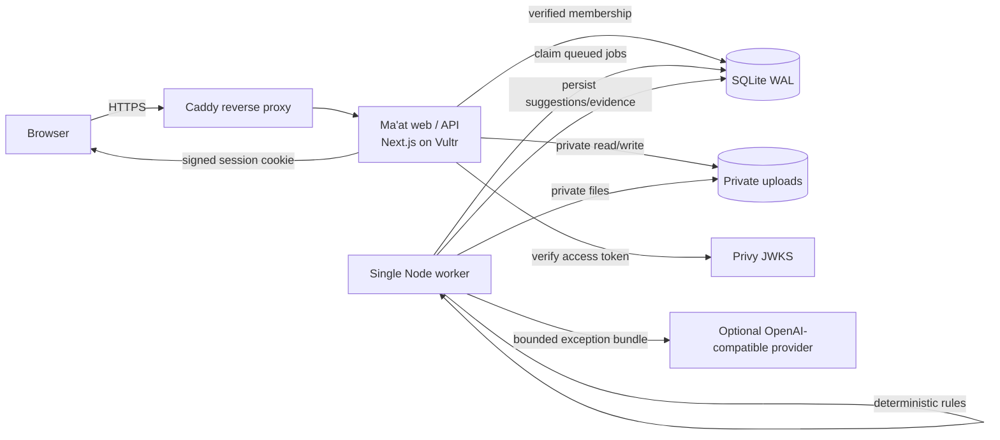

> V2 adds an embedded Agent-Native provider engine, shared evidence/proposal actions, invoice conversations and explicit human proposal review. See [V2 integration](docs/AGENT_NATIVE_INTEGRATION.md) for the new flow and verification limits. The reconciliation engine described below remains the financial source of truth.

> Current release: the owner requested an account-only app. The public demo, automatic samples and guest demo routes have been removed. Real Vultr inference and production email sign-in are verified. See README.md and FIXES_AND_VERIFICATION.md for current behavior; older demo-related descriptions below are historical.

# Architecture

## Deployment shape



Text form:

```
Browser → HTTPS → Caddy → Ma'at web/API (Next.js) → SQLite + private uploads
Durable jobs table → single worker → matching engine → optional LLM → persisted explanations/report
Privy identity (email OTP) → JWKS verification on the server → local user + workspace membership
```

## Runtime processes

- **Web/API** (`maat-web.service`): Next.js server routes, server components, authentication,
  authorization, uploads, review actions, exports, and printable report.
- **Worker** (`maat-worker.service`): one process, bounded concurrency (one job at a time), polling
  the `jobs` table. Claims a job atomically with an `UPDATE ... WHERE status='queued' RETURNING`.

Both use the same SQLite file and upload directory. WAL and `busy_timeout=5000` are enabled. No DB
transaction is held across an AI request.

## Data model

| Table | Purpose |
| --- | --- |
| `users` | Local user keyed by verified Privy DID; optional verified email |
| `workspaces` | Owner workspace or disposable demo workspace |
| `memberships` | User ↔ workspace authorization |
| `demo_sessions` | Server-issued demo sessions, IP hash, timestamps |
| `batches` | Named reconciliation, one currency, status |
| `source_files` | Original filename, SHA-256, private storage key, mapping, validation |
| `invoice_rows` | Source row number, original values, normalized exact minor amount |
| `payment_rows` | Source row number, original values, reference, paid date |
| `suggestions` | Rule type/reason/signals, status, AI provider/model/prompt/evidence |
| `allocations` | Confirmed invoice↔payment amount, source (automatic/review), reversal |
| `review_events` | Append-only actor/action/amount/note/timestamp/reversal link |
| `jobs` | Durable stage, progress, message, error, retry count, idempotency key |
| `reports` | Snapshot metadata: totals + source hashes + generation timestamp |
| `ai_cache` | Validated provider outputs keyed by bundle/provider/model/prompt version |
| `rate_limits` | Hourly demo creation counters, keyed by hashed IP |

All private records carry `workspace_id` (directly or through a checked parent). The server always
resolves the workspace from the signed session plus a membership check.

## Money and invariants

- Amounts are integer minor units (`amount_minor`). Parsing has explicit precision validation.
- Invoice outstanding = `invoice.amount_minor − SUM(active allocations for invoice)`.
- Payment remaining = `payment.amount_minor − SUM(active allocations for payment)`.
- Active allocations: `reversed_at IS NULL`.
- A partial unique index enforces **at most one active allocation per payment**.
- Allocation insert and review event insert are in one `BEGIN IMMEDIATE` transaction. User input is
  revalidated against current invoice outstanding and payment remaining inside that transaction.
- Suggestions never contribute to confirmed totals.
- Invoice status and review state are modelled separately in `lib/batches.ts`.

## Matching pipeline

1. Index unconsumed payments by normalized reference, normalized payer name, amount, and date.
2. For each unreviewed, unallocated invoice:
   - unique exact reference + same currency + exact outstanding → automatic allocation;
   - unique reference with a lower amount → partial suggestion;
   - unique reference with a higher amount → overpayment review;
   - duplicate reference or tied similar candidates → ambiguous without a single candidate;
   - name/amount/date similarity → ambiguity candidate, never automatic;
   - otherwise → “No matched payment in this batch”.
3. Cap candidate lists and only scan indexed candidate pools; no all-pairs comparison.
4. Invoices with any review history are not regenerated, protecting human decisions on rerun.
5. Pending suggestions are replaced safely; accepted/rejected events remain.

## Durable jobs

States: `queued → validating → matching → explaining → completed` or `failed`.

- Matching writes allocations and suggestions in a short transaction.
- AI explanation runs outside any DB transaction and updates each suggestion independently.
- A failed AI call does not remove deterministic results.
- On worker start, jobs stuck in an active state for more than five minutes are reset to `queued`
  (bounded by retry count) or failed. Re-running uses existing allocations and unique constraints, so
  payments cannot be double-allocated.
- Browser polling reads the job row; UI progress reflects persisted stages, not a timer.

## AI contract

Input (truncated, bounded to three candidates):

```json
{
  "invoice": { "row_id": "...", "invoice_id": "INV-010", "customer_name": "...", "amount_minor": 150000, "currency": "USD", "due_date": "...", "source_file": "...", "source_row": 10 },
  "candidates": [{ "row_id": "...", "payment_id": "P010", "amount_minor": 100000, "signals": {} }],
  "deterministic": { "suggestion_type": "partial", "rule_reason": "...", "difference_minor": 50000 }
}
```

Output is validated with Zod:

```json
{
  "explanation": "…",
  "evidence_row_ids": ["invoice row id", "payment row id"],
  "suggested_action": "confirm_partial | keep_unresolved | review_manually",
  "limitations": "…"
}
```

Unknown row IDs, empty evidence, or invalid actions fail validation and become a labelled fallback.
Uploaded text is treated as untrusted data; the system prompt forbids following instructions inside
cells. The model never receives full files and never writes to financial tables.

## Security boundaries

- Signed HttpOnly session cookie (HMAC-SHA256, expiry), `SameSite=Lax`, `Secure` when `APP_URL` is HTTPS.
- Privy access token verified server-side against JWKS; no client-supplied authorization IDs.
- Cross-site mutation protection via Origin / `Sec-Fetch-Site` checks.
- Upload type/size/origin checks, random storage keys, path traversal guard, private directory,
  authenticated export handlers, no arbitrary HTML serving.
- Secrets are server-only. AI keys and session secret never reach the client.
- Health endpoint exposes status only.
- Logs avoid tokens, secrets, and raw customer rows.
