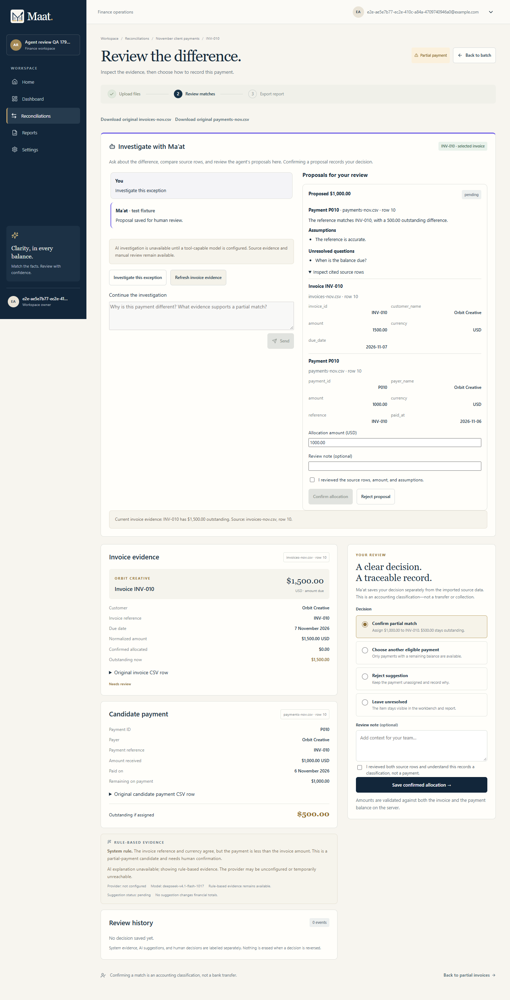
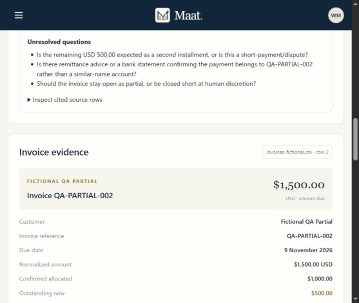
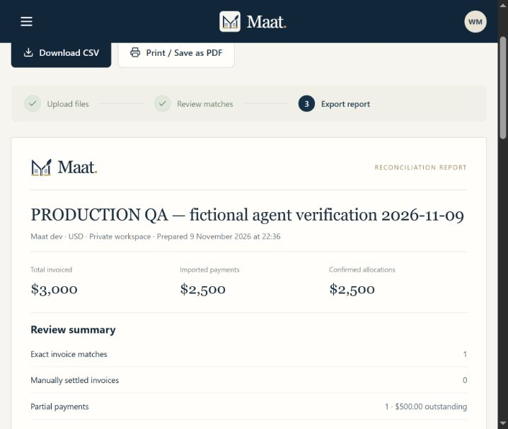
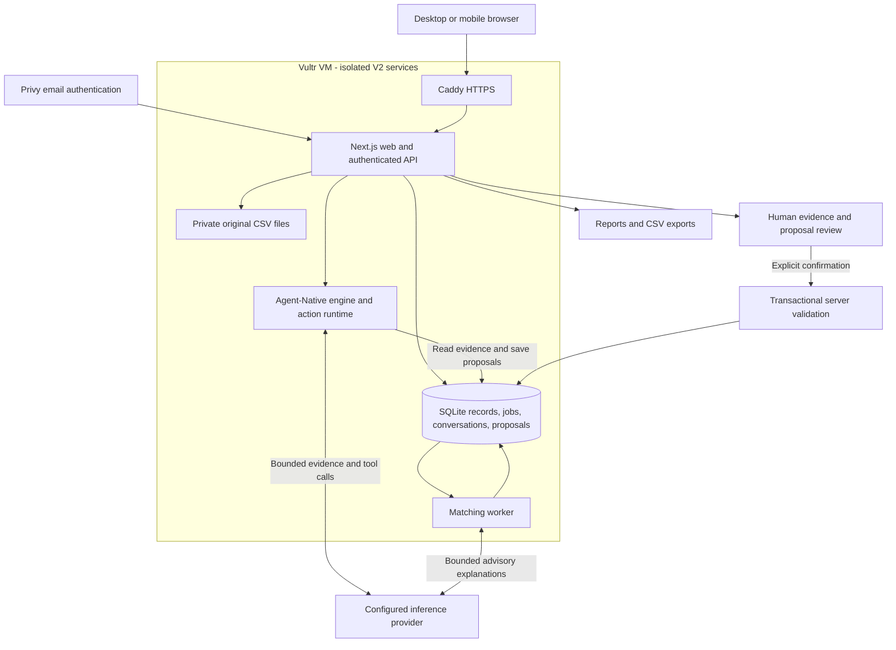

<div align="center">


# Ma'at V2

**Investigate with an agent. Decide with evidence.**

Invoice and payment reconciliation with shared Agent-Native actions, cited evidence, and human review.

[Live V2 app](https://maatv2.199-247-1-174.sslip.io/) · [Watch the demo](https://clips.agent-native.com/r/Dde2h1Un61Ry) · [Product tour](#product-tour) · [Agent-Native integration](#agent-native-integration) · [Run locally](#run-locally) · [Documentation](#documentation)

</div>

An invoice says $1,500. A payment arrives for $1,000. Ma'at V2 helps a finance team investigate the difference, inspect the original records, and decide how to account for the payment. Clear matches use deterministic rules. For exceptions, an agent reads current evidence and saves a proposal for a person to review. An explicit, server-validated confirmation records the proposed allocation.

V2 is deployed separately from [Ma'at V1](https://github.com/vickman787/maat). It retains the existing reconciliation foundation and adds an embedded Agent-Native investigation workflow. The [2:14 public Clips walkthrough](https://clips.agent-native.com/r/Dde2h1Un61Ry) shows the working V2 application using fictional records.

## At a glance

| Area | Implementation |
| --- | --- |
| Workflow | Upload CSVs, validate, match, investigate, review, and export |
| Clear matches | Exact invoice reference, currency, and amount checks |
| Agent capabilities | Read the selected invoice, search eligible payments, save a cited proposal |
| Shared actions | Real `defineAction` implementations executed through the Agent-Native action runtime |
| Conversations | Persisted history scoped to the selected invoice and authorized workspace |
| Human control | Inspect citations, edit the amount, reject, or explicitly confirm a proposal |
| Financial checks | Transactional balance validation, evidence freshness checks, and auditable reversals |
| Accounts | Privy email sign-in, server-verified sessions, and private workspaces |
| AI | Configurable OpenAI-compatible endpoint; live verification used Vultr inference |
| Hosting | Vultr VM, Caddy HTTPS, Next.js web/API, and a separate matching worker |
| Storage | SQLite, durable jobs, private source CSVs, conversations, and proposals |
| Interface | Responsive desktop and mobile review layouts |
| License | [MIT](LICENSE) |

## Product tour

New accounts start with an empty workspace. Sign in and upload your own CSVs to try the application. Screenshots and video use fictional records; there is no public guest workspace or automatic sample seeding.

### Investigate an exception

Open an invoice from the workbench and ask the agent to investigate. It compares the invoice with eligible payments, explains differences, and prepares a structured proposal. The evidence refresh control uses the same `read_invoice` action as the agent.



This desktop capture is from the local V2 acceptance fixture. It demonstrates the interface; live provider and deployed workflow checks are documented separately below.

### Review the evidence and confirm

Inspect cited invoice and payment rows, assumptions, and unresolved questions. A saved proposal changes no balances. Reviewers explicitly acknowledge the evidence before confirmation; the server checks the current state again.



In the production check, a $1,000 payment was confirmed against a $1,500 invoice. Reloading preserved the allocation, $500 outstanding balance, conversation, and review note. Allocations are accounting classifications; the application does not transfer money.

### Verify the report

Reports carry confirmed decisions and unresolved balances through to exports. Reconciliation results, unallocated payments, and decision history have separate CSV downloads. The printable report can be saved as PDF through the browser.



The production verification batch contained $3,000 in invoices and $2,500 in payments. Its report showed $2,500 confirmed and $500 outstanding after review. See the [production verification record](docs/PRODUCTION_AGENT_VERIFICATION.md) for the flow and observed limitations.

## How it works

1. **Sign in and name your workspace.** Privy verifies the email sign-in; the server establishes a workspace-scoped session.
2. **Upload two CSVs.** Map invoice and payment columns and inspect validation. Original rows remain alongside normalized values.
3. **Match clear cases.** The background worker applies exact reference, currency, and amount rules.
4. **Investigate an exception.** The agent reads the selected invoice, searches eligible payments, and saves a cited proposal. Follow-up questions retain invoice context.
5. **Record a reviewed decision.** Inspect source rows, edit the amount if needed, and confirm explicitly. Changed evidence or invalid balances block confirmation.
6. **Export the result.** Download reports and CSVs with unresolved items and decision history preserved. Undo appends a reversal instead of deleting the original decision.

## Agent-Native integration

V2 embeds `@agent-native/core` into the existing Next.js application. Its supported AI SDK engine translates provider streams and tool calls; the application adapter executes validated actions and persists investigation results. Existing Privy sessions and SQLite storage remain in use.

| Action | Capability | Allocation effect |
| --- | --- | --- |
| `read_invoice` | Read the selected invoice, source evidence, and current review state | None |
| `list_candidates` | Search eligible payments and compute differences from current balances | None |
| `propose_decision` | Save a proposal with inspected evidence IDs, rationale, assumptions, and questions | None |

The server binds the authenticated user, workspace, batch, and invoice. The model cannot choose those identities. Citations must reference inspected, eligible rows. Confirmation and reversal use authenticated human review controls and are never model tools.

Investigations are bounded to six provider steps, twelve tool calls, and 90 seconds per run. A database lease prevents overlapping runs and supports recovery after interruption. Follow-ups receive the latest six completed exchanges; the interface displays the latest 30 runs and 50 proposals. New investigations are limited to 30 per user/workspace per hour.

This is an embedded engine/action integration with an application-owned conversation panel. It does not mount the standard Nitro/PostgreSQL scaffold or expose a public MCP server. See [integration details](docs/AGENT_NATIVE_INTEGRATION.md), [actions](lib/agent/actions.ts), [runtime](lib/agent/runtime.ts), and [proposal storage/review](lib/agent/store.ts).

## Architecture



The matching worker handles deterministic reconciliation and the inherited bounded AI explanations. Interactive V2 investigations run through the authenticated web API. Both use the configured inference provider. Keys stay on the server; relevant exception evidence is processed by the external provider when AI is enabled.

Money is calculated in integer minor units. Confirmation checks workspace ownership, currency, available payment balance, invoice balance, and a fingerprint of the proposal's financial evidence inside the review transaction.

## Run locally

Requires **Node.js 22+** and **pnpm**. The package-manager version is pinned in [package.json](package.json).

```sh
git clone https://github.com/vickman787/maatv2.git
cd maatv2
pnpm install --frozen-lockfile
```

Copy `.env.example` to `.env.local` before migrating or starting. Use `cp .env.example .env.local` on macOS/Linux or `Copy-Item .env.example .env.local` in PowerShell. Generate a fresh session secret:

```sh
node -e "console.log(require('node:crypto').randomBytes(32).toString('hex'))"
```

Paste the result into `SESSION_SECRET` locally. Keep `.env.local` out of Git.

| Variable | Purpose |
| --- | --- |
| `NEXT_PUBLIC_PRIVY_APP_ID` | Your Privy application's public browser ID |
| `PRIVY_APP_ID` | Matching application ID for server verification |
| `APP_URL` | `http://localhost:3200` for development |
| `SESSION_SECRET` | Fresh random secret for signed V2 sessions |
| `DATABASE_URL` | `file:./data/maatv2.db` by default |
| `UPLOAD_DIR` | `./data/uploads`, outside the public directory |
| `AI_BASE_URL` | OpenAI-compatible inference URL; the example uses Vultr |
| `AI_API_KEY` | Provider credential, stored locally/server-side |
| `AI_MODEL` | Model supporting streamed chat completions and function/tool calls |
| `UPLOAD_MAX_MB` / `CSV_MAX_ROWS` | Default limits: 5 MB and 5,000 rows per CSV |

Use your own Privy application and allow `http://localhost:3200` as an origin. Set both Privy IDs consistently. Server verification uses Privy's JWKS; `PRIVY_APP_SECRET` is optional unless adding server-side Privy API calls.

```sh
pnpm migrate
pnpm dev
```

Open **http://localhost:3200**. `pnpm dev` starts both the web server and matching worker. Sign in and create an empty workspace. Missing AI settings disable new investigations; evidence inspection and manual reconciliation remain available.

For production, build once and run the web and worker in separate processes:

```sh
pnpm build
pnpm start
# In a separate terminal or service:
pnpm worker:prod
```

The reviewed deployment uses a full dependency installation with `next start`. Standalone packaging remains unverified; do not deploy only the default build's traced files. See [deployment notes](DEPLOYMENT.md) and [build details](docs/AGENT_NATIVE_INTEGRATION.md).

## Verification

| Check | Command |
| --- | --- |
| Unit/integration tests | `pnpm test` |
| TypeScript | `pnpm typecheck` |
| ESLint | `pnpm lint` |
| Production build | `pnpm build` |
| Chrome acceptance tests | `pnpm test:e2e` |
| Live original AI explanation | `pnpm verify:ai` |
| Live Agent-Native tool orchestration | `pnpm verify:agent` |

The recorded verification run passed **68 unit/integration tests**, TypeScript, ESLint, the production build, and all seven Chrome acceptance scenarios. The engine/provider contract test uses simulated streams. Browser tests use isolated fixtures on port **3201**, disable provider traffic, and do not reuse an existing server. These checks are distinct from live inference.

Both live AI verification commands passed with the configured provider. `verify:agent` creates isolated in-memory fixture records, checks that a proposal is saved, and verifies confirmed totals remain unchanged. It does not use account records. Live checks require credentials and can incur provider charges.

Production verification additionally exercised real Privy sign-in, CSV import, live investigation, follow-up, explicit confirmation, reload persistence, and report totals with fictional records. See [the full test report](docs/FULL_TEST_REPORT.md) and [production findings](docs/PRODUCTION_AGENT_VERIFICATION.md). These are recorded results, not guarantees for every environment or future provider configuration.

## Deployment and V1 isolation

| Resource | V2 | Preserved V1 |
| --- | --- | --- |
| Public origin | [maatv2.199-247-1-174.sslip.io](https://maatv2.199-247-1-174.sslip.io/) | [199-247-1-174.sslip.io](https://199-247-1-174.sslip.io/) |
| Server directory | `/opt/maatv2` | `/opt/maat` |
| Runtime configuration | `/etc/maatv2/maat.env` | `/etc/maat/maat.env` |
| Web port | `127.0.0.1:3200` | 3000 |
| Services | `maatv2-web`, `maatv2-worker` | `maat-web`, `maat-worker` |
| Database/uploads | V2's own `data/maatv2.db` and `data/uploads` | Existing V1 data |
| Session cookie | `maatv2_session`, separate secret | Existing V1 session |

Caddy terminates HTTPS. V2 has its own service user, configuration, data, and memory caps on the shared Vultr VM. The 1 GB host has not been load-tested; current evidence establishes a working low-traffic flow. The production build was prepared locally, with Linux dependencies installed on the server. See [DEPLOYMENT.md](DEPLOYMENT.md) for operations and capacity observations.

## Current limitations

- USD batches only; mixed currencies and FX conversion are outside this MVP.
- CSV ingestion only; no bank connections, OCR/PDF ingestion, accounting-system sync, or money movement.
- One owner workspace per user; no team invitation or workspace-switching interface.
- A payment can belong to at most one invoice; multiple payments can settle an invoice through review.
- Model prose can be wrong. Production testing observed an incorrect outstanding figure that a follow-up corrected; the structured proposal and ledger stayed correct.
- Production testing also found stale hypothetical candidate-preview wording after confirmation. Persisted balances and report totals were correct. This display issue remains recorded for repair.
- No load-capacity guarantee, regulatory certification, or formal accessibility certification. Standalone packaging is unverified.
- Rejection, reversal, CSV exports, and authorization boundaries have local coverage; they were not all repeated in the focused production check.

## Demo and provenance

[Watch the public V2 demo on Clips](https://clips.agent-native.com/r/Dde2h1Un61Ry). The walkthrough uses one fictional case, shows a $1,000 partial allocation against a $1,500 invoice, and ends with the saved report. Narration is synthetic OpenAI Marin speech, with original locally generated background music. Sign-in occurred off camera. Idle waits were trimmed; the revised recording retains the full browser viewport at normal speed.

The pre-existing foundation is [Ma'at V1](https://github.com/vickman787/maat) at commit `10eb8c5`: account-only reconciliation, CSV import/validation, deterministic matching, evidence review, bounded Vultr explanations, reversals, and exports. V1 history and the MIT license are retained.

V2's event contribution adds shared Agent-Native actions, the supported provider engine, invoice-scoped conversations, persisted proposals with inspected citations, and explicit human review with transactional balance and evidence-freshness checks. The [inherited V1 README](docs/MAAT_V1_README.md) documents the earlier application. Historical V1 screenshots do not establish V2 behavior.

## Repository layout

```text
app/                  Next.js pages and authenticated API routes
components/           Responsive UI, investigation panel, and review controls
lib/agent/            Shared actions, conversation runtime, and proposal storage/review
lib/                  Authentication, imports, matching, balances, jobs, and reports
worker/               Background reconciliation worker
scripts/              Migration, backup, deployment, and verification tools
tests/                Unit/integration tests, Chrome scenarios, and isolated fixtures
public/               Public brand assets
docs/                 Integration, verification, provenance, and screenshots
deploy/               Caddy and systemd service templates
```

Private runtime data, uploads, credentials, and raw recordings are excluded from Git.

## Documentation

| Document | Contents |
| --- | --- |
| [Agent-Native integration](docs/AGENT_NATIVE_INTEGRATION.md) | Engine adapter, actions, proposal lifecycle, and build constraints |
| [Full test report](docs/FULL_TEST_REPORT.md) | Automated and live-provider verification coverage |
| [Production verification](docs/PRODUCTION_AGENT_VERIFICATION.md) | Deployed workflow results and observed issues |
| [Deployment](DEPLOYMENT.md) | V2 hosting, service limits, and V1 separation |
| [V2 build plan](docs/V2_BUILD_PLAN.md) | Event scope and implementation plan; checklist records earlier milestones |
| [Inherited architecture](ARCHITECTURE.md) | Original reconciliation components and data boundaries |
| [V1 README](docs/MAAT_V1_README.md) | Documentation of the pre-existing foundation |
| [Historical V1 deployment](docs/MAAT_V1_DEPLOYMENT.md) | Preserved V1 operational reference |

V2 verification records and current limitations above take precedence over older V1 status notes and earlier checklist entries.

## License

[MIT](LICENSE), copyright 2026 vickman787. Original Ma'at copyright and third-party licenses are retained.
