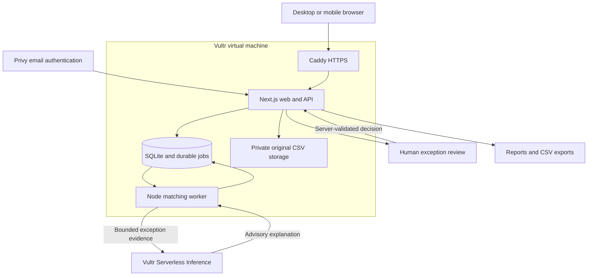

<div align="center">


# Ma'at

**Know what's paid, what's missing, and why.**

Invoice and payment reconciliation with source evidence, human review, and Vultr AI.

[Live app](https://199-247-1-174.sslip.io) · [Product tour](#product-tour) · [How it works](#how-it-works) · [Vultr architecture](#vultr-architecture) · [Run locally](#run-locally) · [Documentation](#documentation)

</div>

Ma'at reconciles invoice and payment CSVs in a private, signed-in workspace. Exact reference, currency and amount matches are allocated by deterministic rules. Exceptions retain their source evidence for human review; AI explains them without changing financial totals.


## At a glance

| Area | Implementation |
| --- | --- |
| Workflow | Upload invoice and payment CSVs, validate rows, match, review and export |
| Matching | Deterministic exact reference, currency and amount checks |
| Exceptions | Partial payments, ambiguous candidates, unpaid invoices and unallocated payments |
| Human control | Confirm, choose another eligible payment, reject, leave unresolved or reverse a decision |
| AI | Live Vultr Serverless Inference explanations with source-row references; advice cannot change totals |
| Accounts | Privy email sign-in, server-verified sessions and private workspaces |
| Hosting | Vultr VM, Caddy HTTPS, Next.js web/API and a separate Node matching worker |
| Storage | SQLite, durable jobs and private original CSV files |
| Interface | Responsive desktop and mobile layouts |
| License | [MIT](LICENSE) |

## Product tour

These are actual application captures. The signed-in screens below use fictional invoice and payment files intentionally uploaded for the recorded walkthrough. The balances are demonstration results, not customer records. New accounts start empty; there is no public guest demo or automatic sample seeding.

### Reconciliation workbench

Review the matching summary, filter invoice statuses, and open the evidence for a particular invoice. Exact matches and items requiring review remain visibly distinct.


### Source evidence and AI explanation

Compare the original payment information with a bounded AI explanation. This real Vultr response identifies a $1,000 payment against a $1,500 invoice and a $500 difference. A person must confirm an allocation; the explanation alone changes no totals.


### Reports and exports

Export reconciliation results, unallocated payments and decision history separately, or print the report. Unresolved items remain part of the report.


### Reversible decisions and mobile access

Undo appends a reversal without erasing the original confirmation. Smaller screens use stacked information and mobile navigation.


<p align="center">
  
</p>

## How it works

1. **Sign in and create a workspace.** Use an email code and name your business.
2. **Upload two CSVs.** Map invoice and payment columns, then inspect validation before matching.
3. **Match the clear cases.** The worker checks exact invoice reference, currency and amount together.
4. **Review exceptions.** Inspect original rows, candidate payments, computed differences and any AI advice.
5. **Record your decision.** The server validates a confirmation and preserves its audit event. An allocation is an accounting classification, not a bank transfer.
6. **Export the result.** Download reports and CSVs with unresolved items and decision history retained.

## Account and data behavior

Visitors sign in with a Privy email code. After naming their business, users start with an empty workspace. Returning members open their dashboard from the homepage. There is no public demo, automatic sample seeding or fictional dashboard balance. Each workspace shows only its own uploaded records.

The desktop interface uses side-by-side evidence and review panels where space permits; smaller screens use stacked panels and invoice cards.

## Features

- Two CSV uploads, column mapping, row-level validation, currency consistency and integer minor-unit arithmetic.
- Durable background matching with startup recovery and bounded retries.
- Exact matches, partial payments, ambiguous candidates and unresolved balances.
- Original CSV values and authenticated original-file downloads.
- Human confirmation, alternate payment selection, rejection, unresolved decisions and auditable reversal.
- Reports and CSV exports including unresolved invoices and unallocated payments.
- Real Vultr Serverless Inference explanations, labelled as advice with source-row citations. Formatted currency values prevent minor-unit confusion. Rules remain available during provider failures.
- Server-verified Privy sessions and workspace-scoped data access.

## Vultr architecture

The live backend and web app run on the Vultr VM at 199.247.1.174. Caddy terminates HTTPS and forwards requests to a Next.js process. A separate systemd-managed Node worker polls durable jobs in SQLite. Uploaded CSVs are private files scoped to a workspace. The worker performs deterministic matching, then sends only bounded exception bundles to Vultr Serverless Inference. Human review is required for uncertain allocations.

Browser → Caddy HTTPS → Next.js web/API → SQLite and private CSV storage → durable job queue → matching worker → Vultr Serverless Inference → human review → transactional allocations and CSV/report exports.



Privy provides email authentication, and tokens are verified by the server. The inference model is deepseek-v4.1-flash-1017. The model explains supplied evidence; it cannot write allocations or change totals. Service health checks, backups and rollback archives protect releases. This is one VM with separate web/worker processes, not a distributed cluster.

## Run locally

Requires Node.js 22+ and pnpm. Install dependencies with pnpm install. Configure .env.local using .env.example, including Privy identity settings, APP_URL, SESSION_SECRET, DATABASE_URL and UPLOAD_DIR. Inference uses AI_BASE_URL, AI_API_KEY and AI_MODEL; keep secrets out of Git.

Run pnpm migrate, then pnpm dev. Production: pnpm build, then pnpm start and pnpm worker:prod in separate processes.

Useful checks: pnpm test, pnpm lint, pnpm typecheck and pnpm test:e2e. pnpm verify:ai uses a fictional isolated exception to verify the configured provider and writes private evidence under data/.

## Verification and release

See FIXES_AND_VERIFICATION.md for results and remaining external acceptance steps. Production uses an existing Linux VM, SQLite, private uploads, and separate web/worker systemd services. Deployment takes a database/upload backup and a rollback archive before changing the running release.

Regression fixtures live under tests/fixtures and are never automatically loaded into an application account. scripts/clear-demo-data.ts removes legacy public-demo workspaces and explicit E2E identities after a backup. It leaves personal accounts and their uploads intact.

## Video

DEMO_VIDEO_PLAN.md prepares the owner-selected 2 minute 30 second walkthrough. Recording uses a dedicated signed-in workspace and intentionally uploaded demonstration files. No public guest demo is required.

## License

MIT, copyright 2026 vickman787. See LICENSE. Third-party dependencies retain their respective licenses.

## Repository layout

```text
app/                  Next.js pages and API routes
components/           Shared responsive interface components
lib/                  Authentication, persistence and reconciliation logic
worker/               Background matching worker
scripts/              Migration, backup, deployment and verification tools
tests/                Automated checks and isolated CSV fixtures
public/               Public brand assets
docs/screenshots/     Product tour and responsive layout captures
deploy/               Production service and hosting configuration
```

## Documentation

| Document | Contents |
| --- | --- |
| [Architecture](ARCHITECTURE.md) | Application components and data boundaries |
| [Deployment](DEPLOYMENT.md) | Hosting and operational setup |
| [Fixes and verification](FIXES_AND_VERIFICATION.md) | Release validation and acceptance notes |
| [Verification record](VERIFICATION.md) | Additional implementation checks |
| [Known limitations](KNOWN_LIMITATIONS.md) | Current scope and limitations |
| [Demo walkthrough](DEMO_VIDEO_PLAN.md) | Planned 2:30 recording sequence |
| [Submission checklist](SUBMISSION_CHECKLIST.md) | Submission preparation |

Product-tour images are copied from the real recorded application run. Other captures in `docs/screenshots/` include historical automated layout checks; they are not a claim that public demo access is available.
